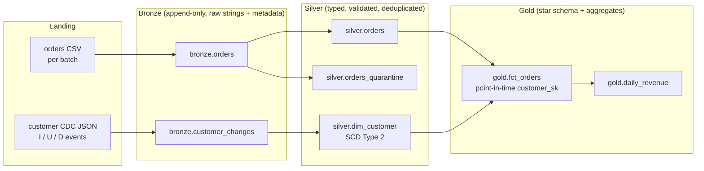

# spark-medallion-lakehouse

A PySpark Bronze / Silver / Gold pipeline that handles the parts of lakehouse work that usually go wrong in production: **replayed files, late and corrected records, invalid rows, customer changes over time (SCD Type 2 from CDC events), deletes, and facts that must join to the dimension version that was valid when the event happened.**

> **Portfolio note.** An independently written, representative project using generated synthetic data. It is not code from, and does not describe the systems of, any employer or client.

## Architecture



## What each layer does

| Layer | Behaviour |
|---|---|
| Bronze | Reads with an explicit all-string schema so malformed values never break ingestion; adds `_batch_id`, `_ingest_ts`, `_source_file`; append-only and partitioned by batch for replay and audit |
| Silver orders | Casts types, validates five rules and writes failing rows to a quarantine table with a reason list (`invalid_amount,invalid_status`). **The batch is stopped if more than 5% of rows fail**, which usually means an upstream change rather than bad records. Keeps the latest version of each order across batches |
| Silver dim_customer | Applies CDC events as SCD Type 2: new versions on attribute change (hash compare), expiry on delete with `is_deleted`, no-op on identical or stale events, so **re-running a batch does not change the table** |
| Gold | `fct_orders` joins each order to the customer version valid at `order_ts`; unmatched orders get an unknown member (`-1`) instead of being dropped, so totals reconcile with Silver. `daily_revenue` aggregates by date and state |

## Quick start

Requires Python 3.10-3.12 and Java 17.

```bash
python -m venv .venv && source .venv/bin/activate
pip install -e ".[dev]"
python scripts/generate_data.py                 # synthetic landing data (already committed)
pytest -q                                       # unit + end-to-end tests on local Spark
python -m lakehouse.job --landing data/landing --lakehouse build/lakehouse
```

Each batch prints its run statistics, for example:

```json
{"batch_id": "2026-01-02", "orders_received": 305, "orders_quarantined": 3, "orders_valid_deduped": 302,
 "dim_customer_rows": 52, "dim_customer_current": 50, "fct_orders_rows": 600}
```

Docker: `docker build -t medallion . && docker run --rm medallion`

## Tests

| Test | What it proves |
|---|---|
| `test_clean_orders_quarantines_and_dedupes` | Every invalid row is quarantined with the right reasons; the newest version of an order wins |
| `test_scd2_lifecycle` | Change, delete, no-op, stale event and new customer all handled; replaying a batch is idempotent |
| `test_point_in_time_fact_and_revenue` | Orders map to the customer version valid at order time; unknown customers use `-1`; cancelled orders excluded from revenue |
| `test_two_batch_end_to_end` | Two batches through all layers: replayed and corrected orders deduplicated, dimension row counts correct, Gold revenue reconciles with the fact table |

CI runs the suite on GitHub Actions with Java 17 and PySpark 3.5.

## Running on Databricks

- Use `--format delta` (or set table formats in a Databricks job) to write Delta tables.
- `apply_scd2` is written with DataFrame operations so it runs on any Spark. On Delta it becomes one `MERGE INTO` with `WHEN MATCHED AND changed THEN UPDATE SET effective_to=..., is_current=false` plus an insert of the new versions.
- Bronze ingestion maps to Auto Loader (`cloudFiles`) with schema hints; governance (table ACLs, lineage) comes from Unity Catalog.

## Project layout

```
src/lakehouse/   spark.py  bronze.py  silver.py  gold.py  job.py
scripts/         generate_data.py (synthetic CSV + CDC JSON)
data/landing/    two sample batches
tests/           Spark unit and end-to-end tests
```

## Tech stack

PySpark 3.5 (Spark SQL, window functions, AQE), Parquet / Delta Lake, pytest, ruff, Docker, GitHub Actions.

## Security considerations

- Synthetic data only; emails use the reserved `example.com` domain.
- No credentials in code. Cloud storage access should come from instance profiles, managed identities or Unity Catalog external locations, never keys in config.
- Quarantine tables contain raw rejected values and need the same access controls as the source.

## Limitations and next steps

- SCD2 collapses multiple changes to the same customer within one batch to the latest change. Processing full intra-batch history is a straightforward extension (order the events and apply them sequentially).
- Gold is rebuilt from all Silver batches each run; at scale it would be incremental by `order_date` partition.
- Next: Delta MERGE implementation behind a flag, Auto Loader ingestion, data quality expectations with Great Expectations or DLT, and a Databricks Asset Bundle for deployment.

## License

MIT
